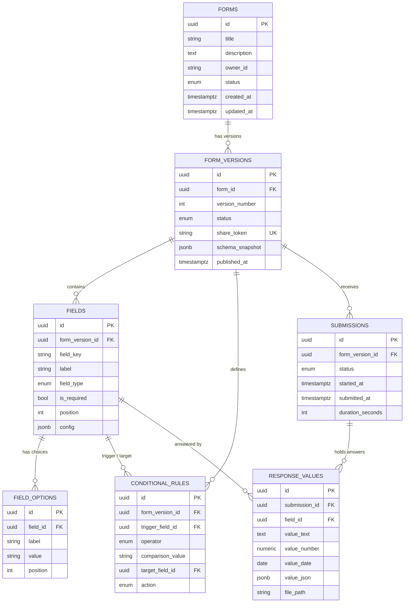

# Database Schema (Task 2)

## ERD (Mermaid – renders on GitHub / VS Code Mermaid preview)

## Tables

| Table | Purpose |
|---|---|
| `forms` | Top-level form (title, owner, status draft/published/archived). |
| `form_versions` | Versioned snapshot of a form. Publishing freezes it (`schema_snapshot`, `published_at`); editing a published form creates version N+1. `share_token` = unique shareable link per version. |
| `fields` | Questions of a version. `field_type` = text, number, email, dropdown, checkbox, date, file, rating. `config` (JSONB) holds per-type constraints (min/max length, number range, date range, file type/size, rating scale). |
| `field_options` | Choices for dropdown / multi-checkbox fields. |
| `conditional_rules` | "If trigger_field `operator` value then `action` target_field". Operators: equals, not_equals, contains, greater_than, is_empty. Actions: show, hide, require. |
| `submissions` | One respondent attempt, linked to the exact version. `started_at`, `submitted_at`, `status`, `duration_seconds` give completion rate and average time. |
| `response_values` | One answer per field per submission, stored in typed columns (text / number / date / json / file info). |

## Key design decisions
- **Versioning**: fields and rules belong to a *version*, so old submissions always match the schema they were answered against.
- **Typed response columns** make filtering and analytics (counts, averages, distributions) fast without parsing JSON.
- **Integrity**: unique `(form_id, version_number)`, unique `(form_version_id, field_key)`, unique `(submission_id, field_id)`, CHECK that a rule's trigger and target fields differ, `ON DELETE CASCADE` everywhere.
- **Indexes** on all foreign keys, `status`, `submitted_at`, `share_token`.
